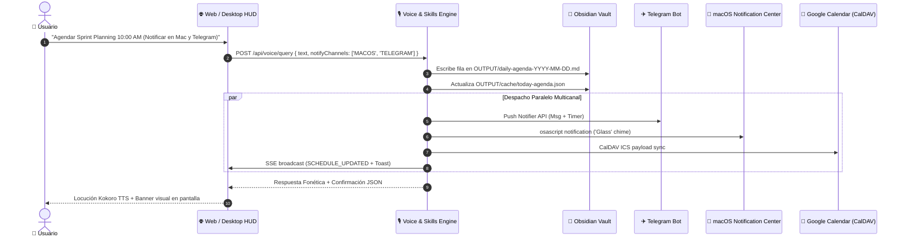

# Caso de Uso: UC-15 — Notificación Multicanal y Sincronización de Calendario (Telegram, macOS, Google Calendar, HUD)

> **ID:** `UC-15` | **Requisito Asociado:** `RF-08`, `RF-15`  
> **Dominio:** Productividad, Integraciones y Notificaciones Omnicanal  
> **Autor:** Jhonny Lorenzo (`jlorenzor`)  
> **Estándar Horario:** `PET / UTC-5 - Hora Perú`

---

## 📋 1. Ficha de Especificación

| Campo | Detalle |
| :--- | :--- |
| **Descripción** | Permite definir dinámicamente o por configuración qué canales deben ser notificados y sincronizados al crear, editar o disparar un recordatorio de calendario (`TELEGRAM`, `MACOS_NOTIFICATION`, `GOOGLE_CALENDAR`, `WEB_DESKTOP_HUD` o `ALL`). |
| **Actores** | Usuario (Voz, Web HUD, App Desktop Tauri, Telegram Bot, Servidor MCP) |
| **Precondición** | El sistema cuenta con acceso al Obsidian Vault y al menos un canal configurado. |
| **Flujo Principal** | 1. El usuario solicita agendar o editar un compromiso especificando o infiriendo el canal (ej: *"Agéndame reunión mañana a las 10am y notifícame por Telegram y en la Mac"*). 2. `CalendarAddEventSkill` o `CalendarEditEventSkill` persiste el compromiso en `daily-agenda-[fecha].md` y actualiza la caché Tier 2 `today-agenda.json`. 3. El despachador multicanal evalúa la lista de canales solicitados (`notifyChannels`):    - **Canal Telegram:** Envía push con formato Markdown a `@TrautsLabBot` y programa temporizador diferido.    - **Canal macOS Nativo:** Ejecuta notificación del sistema con sonido *Glass* en el Notification Center del Mac.    - **Canal Web / Desktop HUD:** Emite evento SSE `SCHEDULE_UPDATED` y despliega toast en pantalla.    - **Canal Google Calendar:** Registra el evento en formato ICS / CalDAV. 4. Se registra la transacción en el monitor de tráfico de canales (`ChannelDispatcher`). |
| **Flujos Alternativos** | - **Sin canal explícito:** Aplica la política por defecto (Notificación en el canal de origen + Toast en HUD). - **Dispositivo offline / sin red:** Prioriza notificación local en macOS y guarda en cola local de reintentos. - **Modo No Molestar (*Focus Mode*):** Silencia locución TTS y envía únicamente banner silencioso. |
| **Postcondición** | El evento queda sincronizado en el Vault y alertado en todos los canales seleccionados. |

---

## 🔄 2. Diagrama de Secuencia Multicanal

---

## ⚙️ 3. Canales Disponibles y Parámetros

| Canal ID | Medio / Protocolo | Comportamiento | Parámetro |
| :--- | :--- | :--- | :--- |
| `TELEGRAM` | Telegram Bot API / Push | Mensaje enriquecido al chat privado con botones interactivos y temporizador. | `notifyChannels: ['TELEGRAM']` |
| `MACOS` | `NSUserNotificationCenter` / `osascript` | Banner nativo con sonido en la esquina superior derecha del Mac. | `notifyChannels: ['MACOS']` |
| `HUD` | Server-Sent Events / AudioContext | Notificación toast en pantalla y locución TTS en vivo. | `notifyChannels: ['HUD']` |
| `GOOGLE_CALENDAR` | CalDAV / REST API | Sincronización bidireccional de eventos en Google Calendar. | `notifyChannels: ['GOOGLE_CALENDAR']` |
| `ALL` | Difusión Omnicanal | Activa todos los canales disponibles simultáneamente. | `notifyChannels: ['ALL']` |

---
[⬅️ Volver a la Tabla de Contenidos de Casos de Uso](./index.md)
