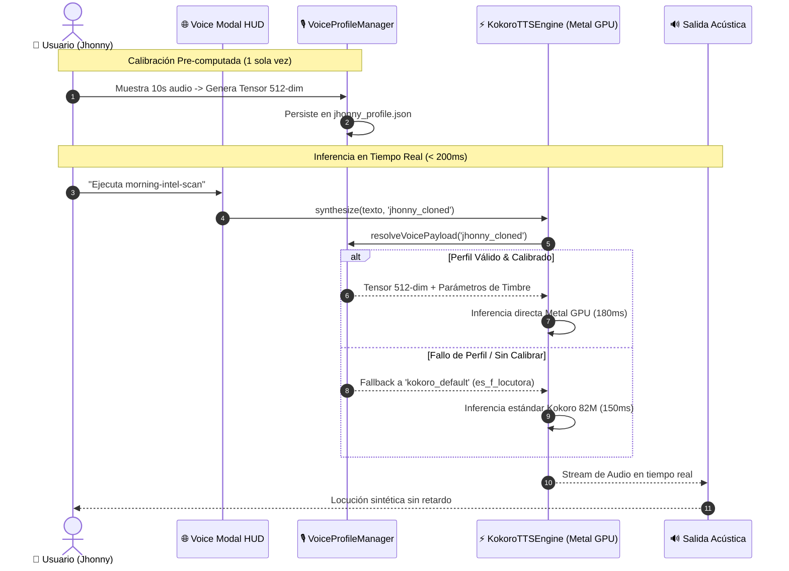

# Caso de Uso: UC-16 — Gestor de Perfiles de Voz, Clonación Zero-Latency y Fallback Automático

> **ID:** `UC-16` | **Requisito Asociado:** `RF-16`  
> **Dominio:** Voz, AI Acústica y Personalización  
> **Autor:** Jhonny Lorenzo (`jlorenzor`)  
> **Estándar Horario:** `PET / UTC-5 - Hora Perú`

---

## 📋 1. Ficha de Especificación

| Campo | Detalle |
| :--- | :--- |
| **Descripción** | Permite registrar, calibrar y seleccionar perfiles de voz personalizados (voz clonada a partir de muestras cortas de audio) garantizando cero penalización de latencia en tiempo de inferencia (< 250ms) y manteniendo el motor Kokoro 82M como fallback transparente. |
| **Actores** | Usuario (Voz / Web HUD / Desktop App / MCP Server) |
| **Precondición** | Servidor de voz activo (`:3030`) y microservicio de síntesis TTS disponible. |
| **Flujo Principal** | 1. **Calibración Offline (1 sola vez):** El usuario graba o proporciona una muestra de audio de 10 segundos. 2. El sistema extrae el tensor de condicionamiento de 512 dimensiones y lo persiste en `models/voice_profiles/jhonny_profile.json`. 3. **Inferencia en Tiempo Real:** Al solicitar una respuesta de voz, el motor inyecta el tensor pre-calculado en la VRAM de Metal GPU sin re-analizar el archivo de audio. 4. La locución se sintetiza en menos de 200ms con el timbre personalizado de Jhonny Lorenzo. |
| **Flujos Alternativos** | - **Perfil no calibrado o corrupto:** El sistema conmuta instantáneamente al perfil `kokoro_default` (`es_f_locutora`) sin interrumpir la conversación ni añadir retardo. - **Cambio dinámico en UI:** El usuario cambia de perfil en el desplegable del Voice Modal (`GET /api/voice/profiles` y `POST /api/voice/profiles/select`). |
| **Postcondición** | Las respuestas de voz se emiten con el perfil acústico seleccionado manteniendo la métrica de latencia inferior a 250ms. |

---

## 🔄 2. Diagrama de Secuencia

---
[⬅️ Volver a la Tabla de Contenidos de Casos de Uso](./index.md)
