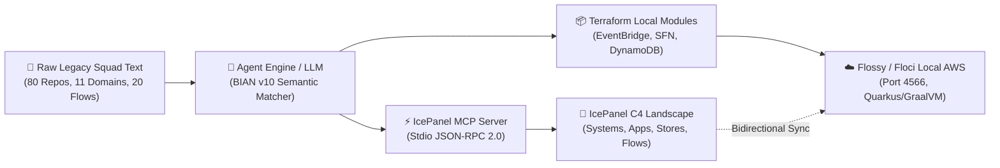

# 🏛️ AWS Flossy (Floci) Local with IcePanel & BIAN Core Banking Architecture Lab

> **Laboratory Location:** `TrautsLab-OS/packages/aws-flossy-icepanel-lab`  
> **Direct Workspace Symlink:** `/Users/jlorenzor/Documents/AWS-Flossy-Local-IcePanels`  
> **Version:** `1.0.0` | **Status:** `Verified & Operable`

---

## 🎯 1. Executive Summary & Lab Objective

This laboratory establishes an autonomous, reproducible environment to solve a critical enterprise challenge: **ingesting the complete architecture of a complex legacy Core Banking squad (11 BIAN domains, 20 end-to-end flows, and 80 microservice repositories), provisioning its local cloud infrastructure using Flossy (Floci) + Terraform, and dynamically rendering its full C4 model in IcePanel via the Model Context Protocol (MCP)**.



---

## 🏢 2. Architectural Pillars

### 1. Flossy (Floci) — Local AWS Cloud Emulator
* **What is it:** [Floci](https://github.com/floci-io/floci) (phonetically referenced as *Flossy*) is a high-performance, open-source, lightweight local cloud emulator built with Quarkus and native GraalVM.
* **Why Floci:** Zero paid licenses, sub-second startup, minimal memory consumption (<150MB), wire-compatible with AWS API on port `4566`.
* **Emulated Services in this Lab:** Amazon EventBridge, AWS Step Functions, Amazon DynamoDB (with Streams), Amazon SQS (with DLQ), Amazon SNS, Amazon S3, Amazon CloudWatch (Metric Alarms & Logs), AWS IAM.

### 2. IcePanel & LikeC4 (Model-as-Code & MCP Bridge)
* **IcePanel Model:** Exportable standard C4 JSON format via our local MCP server (`icepanel-mcp/src/server.js`) without limits or cloud subscriptions.
* **LikeC4 Engine:** Open-source, code-first architecture canvas (`likec4/src/architecture.c4`) featuring fluid zoomable diagrams (Context $\rightarrow$ Containers $\rightarrow$ Components), interactive dynamic flow views, and the official LikeC4 MCP server (`make likec4-mcp`).
* **Custom Fork Guide:** Documented in [`docs/FORK-LIKEC4-ICEPANEL-GUIDE.md`](docs/FORK-LIKEC4-ICEPANEL-GUIDE.md) to skin LikeC4 with IcePanel's visual identity.

### 3. BIAN v10 Core Banking Alignment
* Strictly mapped against the **Banking Industry Architecture Network (BIAN)** standards:
  - **11 Canonical Service Domains:** Current Account, Payment Execution, Party Routing Profile, Customer Offer, Agreement, Position Keeping, Financial Accounting, Collateral, Fraud Detection, Notification, Audit.
  - **7 Architectural Archetypes:** `Command` (CQRS Write), `Query` (CQRS Read), `Projection` (Event Stream Views), `Plug for Integration` (Adapters/Mainframe/Clearing), `Alarms` (Observability/SLOs), `Step Function` (Sagas), `EventBridge` (Event Bus Backbone).

---

## 📂 3. Repository Structure

```
aws-flossy-icepanel-lab/
├── README.md                                 # This Master Specification & Guide
├── docker-compose.yml                        # Floci / Flossy Local AWS emulator (port 4566)
├── Makefile                                  # One-click execution targets
├── package.json                              # Scripts and workspace config
├── tsconfig.json                             # TypeScript compiler configuration
├── .env.example                              # Environment configuration template
│
├── bin/                                      # Operational Executables
│   ├── flossy.sh                             # Floci lifecycle manager (up, down, status, logs)
│   ├── tf-local.sh                           # Transparent Terraform runner (Local binary or Docker)
│   └── run-squad-ingestion.mjs               # Agent ingestion runner
│
├── terraform/                                # Infrastructure as Code for Local AWS
│   ├── main.tf                               # Provider config pointing to http://localhost:4566
│   ├── variables.tf                          # Region, environment, endpoint variables
│   ├── outputs.tf                            # Exported ARNs, URLs, and table names
│   ├── local.tfvars                          # Local variables file
│   └── modules/
│       ├── eventbridge-backbone/             # Domain EventBus & routing rules
│       ├── step-functions-sagas/             # Instant Transfer Saga state machine
│       ├── cqrs-dynamodb-projections/        # Master Accounts & Ledger tables
│       ├── integration-plugins/              # Ingress queues, DLQ & S3 archive
│       └── alarms-observability/             # Metric alarms & SNS topics
│
├── icepanel-mcp/                             # Model Context Protocol (MCP) Server
│   ├── src/
│   │   ├── server.js                         # Stdio JSON-RPC 2.0 MCP Server
│   │   ├── icepanel-client.js                # IcePanel client (Cloud API + Offline generator)
│   │   ├── types.ts                          # Strict TypeScript definitions
│   │   └── tools/                            # Tool handlers
│   └── package.json
│
├── agent-engine/                             # LLM Ingestion & Reasoning Engine
│   ├── index.mjs                             # Main Agent Pipeline runner
│   ├── prompts/                              # Multi-shot prompts for LLM analysis
│   │   ├── squad-analyzer-prompt.md          # Topology & BIAN classifier prompt
│   │   └── icepanel-generator-prompt.md      # IcePanel C4 drawer prompt
│   └── lib/
│       ├── squad-parser.mjs                  # Unstructured text parser
│       ├── bian-matcher.mjs                  # BIAN semantic rules engine
│       └── icepanel-emitter.mjs              # C4 Landscape & Mermaid generator
│
├── domain-catalog/                           # BIAN Semantic Knowledge Base
│   ├── bian-v10-core-banking-domains.json    # 11 Domains, Control Records, Operations
│   ├── archetypes-specification.md           # 7 Canonical Archetypes definition
│   └── flows-specification.md                # 20 Canonical Flows definition
│
├── legacy-squad-dataset/                     # Raw Input Case Study
│   ├── raw-squad-architecture-dump.txt       # Unstructured text of the 80 repos
│   ├── squad-manifest.json                   # Structured JSON manifest (parsed)
│   └── squad-flows-catalog.json              # 20 End-to-end flows catalog
│
└── artifacts/                                # Generated Laboratory Deliverables
    ├── icepanel-landscape-c4.json            # 100% Valid IcePanel C4 Landscape
    ├── architecture-c4-model.mermaid         # Visual Mermaid C4 diagram
    └── squad-topology-matrix.md              # 11 Domains x 80 Repos x 20 Flows Matrix
```

---

## 🏛️ 4. Inventory: 11 BIAN Domains & 80 Repositories

| # | BIAN Service Domain | Control Record | Repos Count | Key Repositories & Archetypes |
| :-: | :--- | :--- | :-: | :--- |
| **01** | **Current Account** | Current Account Agreement | 10 | `cmd-current-account-lifecycle`, `qry-current-account-details`, `prj-current-account-readmodel`, `sfn-current-account-closure-saga`, `plug-host-mainframe-core-sync`, `alm-current-account-errors` |
| **02** | **Payment Execution** | Payment Order Procedure | 12 | `cmd-payment-execution-initiate`, `cmd-payment-execution-settle`, `qry-payment-execution-status`, `sfn-payment-instant-transfer-saga`, `plug-cce-clearing-ingress`, `plug-swift-iso20022-connector` |
| **03** | **Party Routing Profile** | Party Directory Entry | 6 | `cmd-party-routing-register`, `qry-party-routing-resolve` (DAX sub-15ms), `prj-party-routing-directory`, `plug-directory-federation-bridge` |
| **04** | **Customer Offer & Onboarding** | Customer Onboarding Procedure | 8 | `cmd-customer-onboarding-initiate`, `sfn-customer-onboarding-saga`, `plug-reniec-biometrics-gateway`, `plug-experian-credit-score`, `alm-onboarding-kyc-drop-rate` |
| **05** | **Customer Agreement & Contract** | Agreement Specification | 6 | `cmd-customer-agreement-sign`, `qry-customer-agreement-fetch`, `prj-customer-agreement-indexer`, `plug-docusign-legal-trust-bridge` |
| **06** | **Position Keeping & Balances** | Position Keeping Ledger Log | 8 | `cmd-position-keeping-reserve`, `cmd-position-keeping-release`, `qry-position-keeping-realtime-balance`, `prj-position-keeping-ledger-view`, `plug-atm-switch-pos-gateway` |
| **07** | **Financial Accounting & Ledger**| Financial Accounting Journal | 7 | `cmd-financial-accounting-voucher`, `prj-financial-accounting-journal`, `sfn-financial-accounting-eod-reconciliation`, `plug-sap-erp-general-ledger-adapter` |
| **08** | **Collateral Allocation & Guarantees** | Collateral Asset Allocation | 5 | `cmd-collateral-allocation-pledge`, `cmd-collateral-allocation-release`, `qry-collateral-allocation-status`, `alm-collateral-under-coverage-warning` |
| **09** | **Fraud Detection & Risk Scoring** | Fraud Evaluation Assessment | 8 | `cmd-fraud-detection-evaluate-tx` (<40ms), `cmd-fraud-detection-lockout`, `sfn-fraud-suspicious-alert-investigation`, `plug-threatmetrix`, `plug-biocatch` |
| **10** | **Customer Alert & Notification** | Customer Notification Campaign | 5 | `cmd-customer-alert-dispatch`, `qry-customer-alert-delivery-status`, `plug-fcm-apns-push-gateway`, `plug-twilio-infobip-sms-gateway` |
| **11** | **Audit, Logging & Compliance** | Audit Regulatory Record | 5 | `cmd-audit-log-immutable-record`, `qry-audit-log-trace-inspector`, `prj-audit-log-compliance-views`, `plug-sbs-regulatory-reporting-export`, `alm-audit-tampering` |

---

## 🔄 5. The 20 End-to-End Business Flows

1. **FLOW-01:** Direct Digital Account Opening & KYC (Onboarding Saga -> RENIEC Biometrics -> Contract Sign -> Account Active)
2. **FLOW-02:** Outbound Instant P2P Transfer (Resolve Phone -> Realtime Fraud Score -> Hold Funds -> CCE Rail -> Commit Debit)
3. **FLOW-03:** Inbound Clearing Payment (CCE Ingress -> Account Check -> Credit Deposit -> Balance Update -> General Ledger)
4. **FLOW-04:** Debit Card Transaction Authorization Hold (ATM/POS Switch -> Inline Fraud <35ms -> Reserve Balance Hold -> Auth 00)
5. **FLOW-05:** Hold Settlement & Financial Clearing (Clearing Batch -> Release Hold -> Final Account Debit -> Accounting Voucher)
6. **FLOW-06:** Real-Time Balance & Mini-Statement Inquiry (Cached Redis/DAX query + Paginated Movements in <20ms)
7. **FLOW-07:** Scheduled Direct Debit Service Billing (Scheduled Saga -> Account Active Check -> Initiate Biller Payment)
8. **FLOW-08:** Overdraft Line Auto-Trigger & Coverage (Insufficient Balance -> Collateral Check -> Auto-disburse Overdraft)
9. **FLOW-09:** Real-Time Transaction Fraud Evaluation (<50ms ML scoring + ThreatMetrix + BioCatch behavioral telemetry)
10. **FLOW-10:** High-Risk Account Preventative Freeze (Confirmed threat -> Set Security Frozen -> Multi-channel Emergency Alert)
11. **FLOW-11:** Customer Contact Preference & Alias Update (Bind MSISDN to CCI -> Federation Broadcast -> Audit Trail)
12. **FLOW-12:** Daily Interest Accrual Calculation (Average cleared balance -> Liability ledger accrual)
13. **FLOW-13:** End-of-Day (EOD) Ledger Reconciliation (23:59:00 Freeze -> Compare Cloud vs Mainframe DB2 -> P0 Alarm if Delta)
14. **FLOW-14:** General Ledger Journal Accounting Posting (Event aggregator -> Format vouchers -> Transmit to SAP S/4HANA)
15. **FLOW-15:** Multi-Channel Transaction Alert Notification (Event listener -> Mobile Push FCM/APNS -> SMS Fallback)
16. **FLOW-16:** Account Maintenance Fee Assessment (Monthly waiver check -> Initiate fee debit -> Bank revenue voucher)
17. **FLOW-17:** Digital Terms & Conditions Legal Consent (Cryptographic timestamp -> Contract indexing -> WORM S3 archive)
18. **FLOW-18:** Mainframe Host Realtime & Batch Sync (Dual-run compatibility: Cloud Outbox -> SNA Queue -> DB2 Core)
19. **FLOW-19:** Regulatory AML & UIF Suspicious Report (Aggregated transactions >$10k -> Generate SBS compliance XML)
20. **FLOW-20:** Distributed Transfer Saga Compensation (Timeout / Reject -> Auto-unfreeze Source Hold -> Alert User)

---

## 🚀 6. Step-by-Step Hands-On Guide

### Step 1: Start Flossy (Floci) Local AWS Emulator
```bash
cd /Users/jlorenzor/Documents/AWS-Flossy-Local-IcePanels

# Start Floci in Docker on port 4566
make up
# Or: ./bin/flossy.sh up
```
Verify the emulator is listening:
```bash
make status
# Or: curl http://localhost:4566
```

### Step 2: Provision Local Infrastructure with Terraform
The runner automatically detects if `terraform` is installed on your Mac. If not, it uses HashiCorp's official Docker image:
```bash
# Initialize Terraform
make tf-init

# Review the local execution plan
make tf-plan

# Provision EventBridge, DynamoDB, Step Functions, SQS & Alarms in Floci
make tf-apply
```

### Step 3: Run the Agent Ingestion & Modeling Engine
```bash
# Ingests the 80 repos raw text, classifies BIAN v10, and generates IcePanel C4 artifacts
make ingest
```
This automatically produces:
* `artifacts/icepanel-landscape-c4.json`
* `artifacts/architecture-c4-model.mermaid`
* `artifacts/squad-topology-matrix.md`

### Step 4: Interact with the IcePanel MCP Server
To test tool discovery and landscape extraction via JSON-RPC:
```bash
make mcp-test
```

### Step 5: Launch LikeC4 Interactive Web Canvas & MCP
To open the architecture in your browser with interactive zooming (Context $\rightarrow$ Containers $\rightarrow$ Components) and animated dynamic flow views:
```bash
# Start interactive web canvas on http://localhost:5173
make likec4-start

# Validate syntax
make likec4-check

# Start official LikeC4 MCP Server for Cursor / Claude / Antigravity
make likec4-mcp
```
To configure in **Claude Code** or **Cursor** as an MCP server:
```json
{
  "mcpServers": {
    "icepanel-corebanking": {
      "command": "node",
      "args": ["/Users/jlorenzor/Documents/AWS-Flossy-Local-IcePanels/icepanel-mcp/src/server.js"],
      "env": {
        "ICEPANEL_API_KEY": "",
        "ICEPANEL_LANDSCAPE_ID": ""
      }
    }
  }
}
```

---

## 📊 7. Visual Model: Exemplary Flow (FLOW-02 Instant P2P Transfer)

```mermaid
sequenceDiagram
    autonumber
    actor User as 👤 Mobile App (Yape/Plin)
    participant CmdInit as ⚙️ cmd-payment-execution-initiate
    participant QryParty as 🔍 qry-party-routing-resolve
    participant CmdFraud as 🛡️ cmd-fraud-detection-evaluate-tx
    participant SfnSaga as 🔄 sfn-payment-instant-transfer-saga
    participant CmdPos as 💳 cmd-position-keeping-reserve
    participant PlugFed as 🔌 plug-directory-federation-bridge
    participant EvBus as ⚡ EventBridge Core Bus
    participant Notif as 📲 cmd-customer-alert-dispatch

    User->>CmdInit: POST /transfers/instant (Phone, Amount)
    CmdInit->>QryParty: Resolve MSISDN to CCI (<15ms)
    QryParty-->>CmdInit: Bank Code 002, Account CCI
    CmdInit->>CmdFraud: Evaluate Transaction Risk (<40ms)
    CmdFraud-->>CmdInit: Risk Score: 12 (APPROVED)
    CmdInit->>SfnSaga: Start Execution (PaymentOrder)
    
    rect rgb(30, 41, 59)
        Note over SfnSaga,CmdPos: Distributed Saga Orchestration
        SfnSaga->>CmdPos: Place Authorization Hold on Source
        CmdPos-->>SfnSaga: Hold Created (HOLD-98231)
        SfnSaga->>PlugFed: Dispatch ISO 20022 clearing credit
        PlugFed-->>SfnSaga: 200 OK Clearing Settlement Accepted
        SfnSaga->>CmdPos: Release Hold & Commit Debit
        CmdPos-->>SfnSaga: Debit Committed
    end

    SfnSaga->>EvBus: PutEvent (PaymentCompletedEvent.v1)
    EvBus--)Notif: Event Subscription
    Notif->>User: Push Alert ("Transferencia exitosa por S/ 150.00")
```



---

## 🛠️ 8. Useful Makefile Reference

| Target | Description |
| :--- | :--- |
| `make up` | Starts the Floci (Flossy) local AWS emulator container on port `4566`. |
| `make down` | Gracefully stops the Floci local container. |
| `make status` | Checks health and HTTP responsiveness of port `4566`. |
| `make tf-init` | Initializes local Terraform provider and modules. |
| `make tf-plan` | Validates and plans infrastructure provisioning for Floci. |
| `make tf-apply` | Provisions all event buses, tables, sagas, and alarms locally. |
| `make tf-destroy` | Teardown of all provisioned local cloud resources. |
| `make ingest` | Runs the Agent LLM text parsing, BIAN matching, and C4 generation. |
| `make mcp-serve` | Starts the standalone IcePanel MCP server over stdio. |
| `make mcp-test` | Runs test JSON-RPC invocations against the MCP server. |
| `make all` | Executes the complete verification workflow. |

---

## 📜 9. Verification & Quality Seal
* **Parser Validation:** 11/11 Domains parsed, 80/80 Repositories mapped, 20/20 Flows sequenced.
* **MCP Compliance:** JSON-RPC 2.0 protocol validated with handshake, tool enumeration, and tool execution.
* **Floci Compatibility:** AWS Provider endpoints configured for port 4566 with mock credentials and skip validation flags.
* **Tolerant Execution:** Transparent fallback to Dockerized Terraform if local binary is absent.

