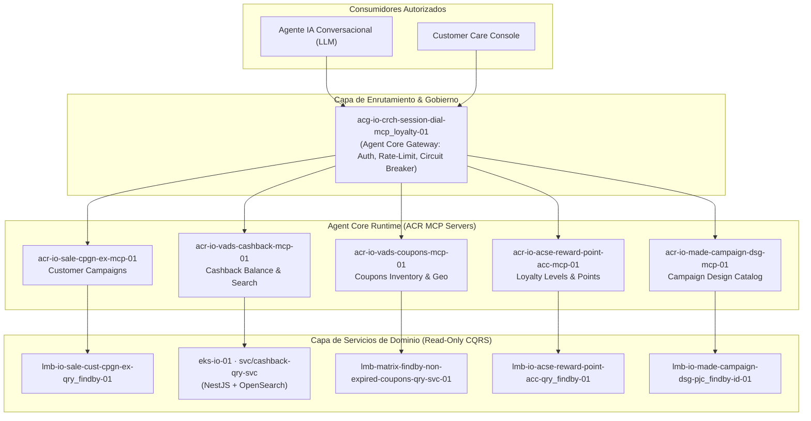

# 🧠 Base de Conocimiento Dozer BCP-iO: Arquitectura Agéntica & Ecosistema de Fidelización

> **Identificador del Caso:** `arch-dozer-components-optimization`  
> **Iniciativa Empresarial:** `SDA-16458` (Aprobación Arquitectura: `ARQ-4864`)  
> **Squad Propietario:** Squad Dozer (Loyalty & Rewards BCP iO)  
> **Población Objetivo:** 132,000 clientes activos de iO (~25,000 conversaciones mensuales estimadas)  
> **Meta Estratégica:** Incrementar la contención del Agente IA conversacional del **38% al 42%**, erradicando derivaciones innecesarias a asesores humanos.  
> **Framework Host:** *Agentic Cloud Simulation & Governance Framework (Floci + LikeC4/IcePanel + MCP + OCC)*

---

## 🎯 1. Resumen Ejecutivo de la Iniciativa SDA-16458

Actualmente, la información de fidelización (Loyalty) de BCP iO reside dispersa en silos operacionales desacoplados: motores de reglas, inventarios de cupones, saldos de cashback en OpenSearch, cuentas de puntos en DynamoDB y proyecciones de campañas Kafka. Esta fragmentación provocaba que el Agente IA de atención al cliente fallara o derivara al 62% de las interacciones sobre beneficios.

La iniciativa **SDA-16458** establece una arquitectura agéntica desacoplada basada en el estándar **Model Context Protocol (MCP)** bajo la gobernanza del **Agent Core Gateway (ACG)**:



---

## 🏷️ 2. Taxonomía y Convención de Nombres BCP iO

Todo repositorio y artefacto cloud en BCP iO sigue una convención estricta:

```
io-{dominio}-{subdominio}-{tipo}-{num}
```

*Ejemplo:* `io-vads-cashback-cmd-01`  
- **`io`**: Identificador corporativo del ecosistema digital iO.  
- **`dominio`**: Bounded Context BIAN de 3 a 4 letras (`vads` = Value Added Services, `sale` = Sales & Campaign, `acse` = Account Servicing, `made` = Marketing & Design, `opse` = Operations Servicing, `crch` = Cross Channel).  
- **`subdominio`**: Función de negocio específica (`cashback`, `coupons`, `reward-point-acc`, `cust-cpgn-ex`).  
- **`tipo`**: Arquetipo arquitectónico CQRS.  
- **`num`**: Instancia numérica de dos dígitos (`01`, `02`).

### Tipos Arquitectónicos y Responsabilidades

| Tipo | Arquetipo CQRS | Patrón de Cómputo | Stack Tecnológico | Rol en el Ecosistema |
|---|---|---|---|---|
| **`cmd`** | Comando (Escritura) | AWS Lambda / EKS | TypeScript / NestJS | Ejecuta mutaciones ACID, valida invariantes y emite eventos de dominio a Kafka/MSK. |
| **`qry`** | Consulta (Lectura) | AWS Lambda / EKS | Node.js / NestJS | Responde consultas síncronas leyendo exclusivamente de Read Models sin mutar estado. |
| **`pjc`** | Proyección (Event Consumer) | AWS Lambda | Event Source MSK | Consume tópicos Kafka (`pe.io.*`) para construir y actualizar Read Models en DynamoDB. |
| **`platform`** | Infraestructura Compartida | Terraform puro | HCL / AWS Provider | Gobierna tablas DynamoDB, tópicos MSK, clusters OpenSearch, S3 buckets y KMS. |
| **`alarms`** | Observabilidad & Alertas | CloudWatch / Terraform | Metric Filters / SNS | Monitorea umbrales de latencia p95, errores 5xx y dead-letter queues (DLQ). |
| **`matrix-container-*`** | Contenedor EKS | Amazon EKS Pods | NestJS 11 + Docker | Servicios de altísimo rendimiento o motores de búsqueda (ej. Cashback OpenSearch). |
| **`acr_*`** | Agent Core Runtime | MCP Server | Python FastMCP / Node.js | Expone contratos JSON Schema tipados como herramientas MCP para LLMs. |
| **`acg_*`** | Agent Core Gateway | API Gateway HTTP / Envoy | AWS API Gateway | Enruta intenciones semánticas, inyecta `correlationId`, aplica Circuit Breaking y Rate Limiting. |

---

## 📋 3. Los 17 Criterios de Aceptación (SDA-16458 / ARQ-4864)

| ID | Criterio | Descripción Técnica |
|:---:|:---|:---|
| **CA1** | **Exposición de Capacidades** | Exposición vía MCP tools desde `acg-io-crch-session-dial-mcp_loyalty-01` hacia componentes de dominio y Lambdas Query sin exposición de puertos internos. |
| **CA2** | **Campañas y Beneficios** | Catálogo comercial completo: vigencia, estados (Online, Legal, Archive), elegibilidad, segmentación, URLs de imágenes y T&C. Consultas individuales y listados filtrados. |
| **CA3** | **Campañas del Cliente** | Consulta de campañas asignadas a un `customerId`, detalle, recompensas configuradas y porcentaje de avance mediante *Customer Campaign Execution*. |
| **CA4** | **Reglas y Evaluación** | Detalle y listado de reglas de recompensa, condiciones, umbrales y estado de evaluación de eventos procesados y montos acumulados. |
| **CA5** | **Progreso y Ejecución** | Historial de participación del cliente: inscripción, estado, avance de misiones/retos y fecha de cumplimiento o rechazo. |
| **CA6** | **Cashback, Puntos y Abonos** | Resumen de cashback acumulado, historial de movimientos, puntos y detalle de canjes, correlacionando con campaña o regla origen. |
| **CA7** | **Niveles de Lealtad** | Consulta del saldo de puntos, nivel actual (Novato, Maestro, Experto), progreso acumulado y monto faltante (`missingAmount`) hacia el siguiente nivel. |
| **CA8** | **Cupones de Descuento** | Inventario de cupones no vencidos, vigencia proximal, código de canje y filtros geográficos por departamento/región. |
| **CA9** | **Correlación y Trazabilidad** | Relación de entidades mediante identificadores unívocos (`customerId`, `campaignId`, `ruleId`), sin asumir llaves compartidas. Cero asociaciones falsas. |
| **CA10** | **Disponibilidad e Histórico** | Consulta de datos recientes con profundidad histórica de hasta **45 días**, diferenciando explícitamente datos inexistentes de datos no aplicables. |
| **CA11** | **Integración y Reutilización** | Consumo homologado mediante el flujo L1/L2 aprobado. Prohibido terminantemente que el Agente IA consulte bases de datos DynamoDB u OpenSearch de forma directa. |
| **CA12** | **Manejo de Errores & Resiliencia** | Tolerancia a fallos: respuestas parciales cuando un subdominio no responda, sin abortar la respuesta completa de fidelización. |
| **CA13** | **Presentación Backend-Only** | El alcance comprende exclusivamente endpoints y herramientas de datos estructurados JSON. El formateo conversacional es responsabilidad del LLM/Canal. |
| **CA14** | **Seguridad y Segregación** | Autenticación basada en IAM/OAuth2, validación de pertenencia por `customerId` y prevención de fugas de datos entre inquilinos. |
| **CA15** | **Observabilidad Transversal** | Inyección obligatoria de `correlationId` y `xray_trace_id` en headers y payload `logData` en todos los saltos de red. |
| **CA16** | **Escalabilidad y Compatibilidad** | Capacidad de absorber 25,000 conversaciones mensuales del parque de 132k usuarios sin degradar la latencia de transacciones operativas. |
| **CA17** | **Validación Integral** | Matriz de pruebas automatizada: escenarios felices, recursos inexistentes (404), timeout de dependencias (504), y concurrencia multi-cliente. |

---

## 🛡️ 4. Estándar de Logs y Errores Dozer (Vigente Confluence)

Todo microservicio en el ecosistema Dozer debe adherirse a los lineamientos estandarizados de telemetría y error cataloging:

### 4.1. Código Canónico de Resultado (`IOResultCode`)
Estructura obligatoria de 9 caracteres validados por regex:
```regex
/^[A-Z]{3}\d{2}[BT]\d{2}[SFW]$/
```

| Componente | Longitud | Descripción | Ejemplos |
|---|---|---|---|
| **Dominio** | 3 letras | Acrónimo oficial del dominio | `VCB` (Cashback), `LAC` (Loyalty Accrual), `CPN` (Coupons) |
| **Servicio** | 2 dígitos | Identificador numérico del microservicio | `01`, `02`, `07` |
| **Tipo** | 1 letra | Naturaleza del código | `B` (Business/Negocio), `T` (Technical/Infraestructura) |
| **Secuencial** | 2 dígitos | Número correlativo | `01`, `02`, `14` |
| **Sufijo** | 1 letra | Estado del resultado | `S` (Success), `F` (Failure/Error), `W` (Warning/Skip) |

*Ejemplos Válidos:*
- `VCB01B01S`: Éxito en consulta de balance de cashback.
- `LAC07T01F`: Falla técnica de conexión a DynamoDB en cuenta de puntos.
- `CPN01B03W`: Advertencia de cupón expirado o filtrado por región.

### 4.2. Invariantes de Logging Dozer
1. **Idioma Inglés Estricto:** Todo mensaje de log y catálogo de error se escribe en inglés.
2. **Mensaje Fijo:** Cero interpolación de variables en la cadena del log (`logger.info("Processing campaign")`, NUNCA `logger.info("Processing campaign " + id)`). Los datos variables van dentro del objeto `data`.
3. **Claves Canónicas en `data`:**
   - Toda entidad referenciada lleva sufijo `Id`: `customerId`, `campaignId`, `ruleId`, `transactionId`. Prohibido `id` suelto en la raíz.
   - Sinónimos prohibidos: `customer` ❌ -> `customerId` ✅; `source` ❌ -> `eventSource` ✅.
4. **Política de Niveles de Log por Entorno:**
   - **DEV / QA:** Nacen **SIN declarar** `LOG_LEVEL` en variables de entorno (modo `SILENT`). Activar temporalmente solo para diagnóstico local.
   - **UAT / PROD:** Nivel **`INFO` obligatorio** gestionado automáticamente por la librería base `@matrixmvp/matrix-artifact-lib-nodejs-logs-function`.
5. **Cero `console.log`:** Terminantemente prohibido el uso de `console.*`. Todo log se emite mediante la instancia inyectada de `Logger`.
6. **Retornos Anticipados (Skips) Rastreables:** Ningún return prematuro es silencioso; debe emitir un log con sufijo `W` o `S` documentando el motivo del skip.

---

## 🤖 5. Catálogo de Agentes y Skills del Ecosistema BCP

El repositorio de conocimiento `/bcp-claude-config-main` estructura los roles operativos de la siguiente forma:

### 5.1. Subagentes Especializados
- **`arquitectura`:** Agente de solo lectura (`disallowedTools: [Write, Edit]`). Evalúa coherencia entre capas, contratos OpenAPI/VTL, trade-offs de latencia y apego a BIAN v12.
- **`backend`:** Agente constructor para Lambdas CQRS (`io-*-cmd/qry/pjc`) y microservicios NestJS en EKS.
- **`frontend`:** Agente enfocado en `matrix-app-front` (React Native 0.75 + TypeScript + Redux Toolkit).
- **`devops`:** Agente enfocado en GitHub Actions, pipelines Terraform Cloud y CloudWatch Logs Insights.

### 5.2. Skills Clave Integrados al Framework
- **`bcp-project-standard`:** Clasificador de repositorios según patrón de nomenclatura.
- **`bcp-qry` / `bcp-cmd` / `bcp-pjc`:** Estándares de desarrollo, VTL templates y parseo de eventos MSK.
- **`bcp-log-glossary` & `bcp-error-catalog`:** Homologación de claves y auditoría de códigos `IOResultCode`.
- **`bcp-cloudwatch`:** Generador automatizado de queries de Logs Insights para reconstrucción de líneas de tiempo de incidentes.
