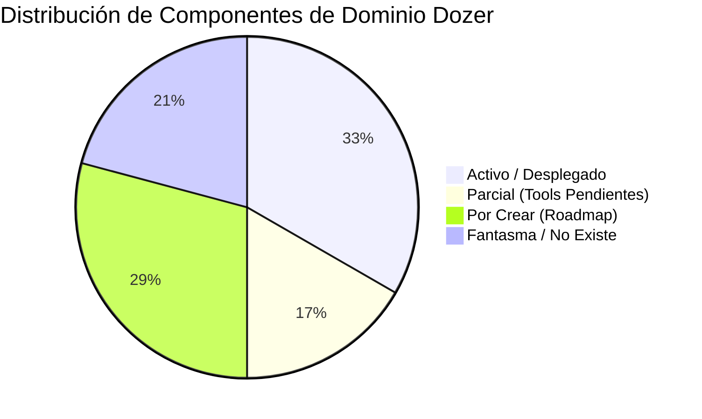
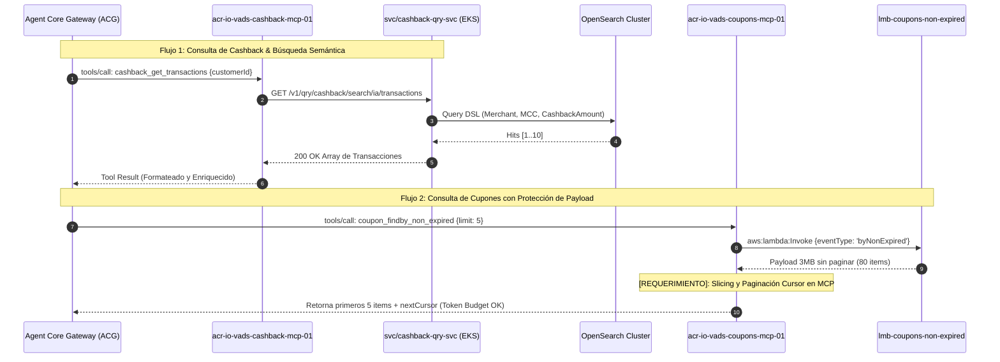

# 📊 Matriz de Componentes MCP & Servicios de Dominio Dozer (SDA-16458)

> **Alcance del Documento:** Inventario exhaustivo y estado de madurez de los componentes de backend y MCP requeridos para la iniciativa de fidelización iO, derivado de la estimación de ingeniería `[BE]-Estimacion_v3.csv` y especificación `ARQ-4864`.

---

## 🗺️ 1. Mapa de Estados de Implementación

En la arquitectura de fidelización Dozer, los componentes se clasifican en 4 cuadrantes operativos:

1. 🟢 **ACTIVO (100% Operativo):** Desplegado en AWS y con contratos cumplidos.
2. 🟡 **PARCIAL (Implementación Incompleta):** Desplegado pero carece de tools MCP clave o requiere agregación intermedia.
3. 🟠 **POR CREAR (Planificado en Roadmap):** Especificado a nivel de arquitectura y DTOs, pero sin código en repositorio o sin pipeline CI/CD.
4. 🔴 **FANTASMA / NO EXISTE (Punto de Colisión):** Referenciado en diagramas conceptuales o configuraciones de API Gateway pero inexistente en el catálogo de repositorios (`github.com/MATRIXMVP`), lo cual dispara fallos en cascada (502 Bad Gateway).

---

## 📑 2. Matriz Detallada de Componentes por Dominio

| Dominio BIAN / Negocio | Tipo | Repositorio GitHub | Componente AWS / Cloud | Estado Operativo | Tools MCP / Operaciones | Puntos Est. | Observaciones Técnicas |
|:---|:---:|:---|:---|:---:|:---|:---:|:---|
| **Cupones** *(Coupons)* | **MCP** | `io-vads-coupons-mcp-01` | `acr-io-vads-coupons-mcp-01` | 🟡 PARCIAL | `coupon_findby_id` (Activa) `coupon_findby_non_expired` (Pendiente) `coupon_findby_department` (Pendiente) | 0.25 pt | Estructura hexagonal Python FastMCP. Realiza invocación outbound con `boto3.client('lambda').invoke()`. |
| **Cupones** *(Coupons)* | **QRY** | `matrix-function-coupons-qry-svc` | `lmb-(env)-matrix-findby-id-coupons-qry-svc-01` | 🟢 ACTIVO | FindById (Detalle de cupón, códigos, vigencia, T&C) | 0.25 pt | Cumple contrato Proposal (a). |
| **Cupones** *(Coupons)* | **QRY** | `matrix-function-coupons-qry-svc` | `lmb-(env)-lmt-findby-non-expired-coupons-qry-svc-01` | 🟢 ACTIVO | FindByList Non-Expired (Cupones vigentes ordenados) | 0.25 pt | Cumple contrato Proposal (b). Requiere paginación por volumen. |
| **Cupones** *(Coupons)* | **QRY** | `matrix-function-coupons-qry-svc` | `lmb-(env)-matrix-findby-dep-coupons-qry-svc-01` | 🟡 PARCIAL | FindByDepartment | 0.25 pt | Retorna array de strings con nombres de departamento. El MCP debe orquestar 2 llamadas para filtrar. |
| **Cashback** | **MCP** | `io-vads-cashback-mcp-01` | `acr-io-vads-cashback-mcp-01` | 🟡 PARCIAL | `cashback_get_balance` (Activa) `cashback_get_transactions` (Activa) `cashback_summary` (Pendiente) `cashback_redemption_detail` (Pendiente) | 0.25 pt | Conexión HTTP REST hacia EKS vía `CASHBACK_QRY_SERVICE_URL`. Manejo de SSL interno y timeout defensivo. |
| **Cashback** | **QRY** | `io-vads-cashback-qry-01` | `eks-(env)-io-01 · svc/cashback-qry-svc` | 🟢 ACTIVO | `/getPoints` `/search/ia/transactions` `/search/ia/summary` `/redemptions/:id` | 0.25 pt | NestJS en Amazon EKS. Expone búsquedas optimizadas directamente sobre cluster Amazon OpenSearch. |
| **Campañas del Cliente** *(Customer Campaigns)* | **MCP** | `io-vads-cust-cpgn-mcp-01` | `acr-io-sale-cpgn-ex-mcp-01` | 🔴 NO EXISTE | `customer_campaigns_findby_id` `customer_campaigns_findby_list` | 0.25 pt | Componente referenciado en diagramas L2 pero inexistente en GitHub. Provoca 502 Bad Gateway si es llamado por el ACG. |
| **Campañas del Cliente** *(Customer Campaigns)* | **QRY** | `io-sale-cust-cpgn-ex-qry-01` | `lmb-(env)-io-sale-cust-cpgn-ex-qry_findby-01` | 🟢 ACTIVO | `byCampaignId` `byCampaignAll` | 0.25 pt | Handler único que discrimina por `eventType`. Valida `filterType` (`LEVEL`, `ALL`, `CATEGORY`). |
| **Reward Points Account** *(Niveles / Saldo)* | **MCP** | `io-vads-reward-point-acc-mcp-01` | `acr-io-acse-reward-point-acc-mcp-01` | 🔴 NO EXISTE | `reward_points_get_account_detail` | 0.25 pt | Debe crearse siguiendo el estándar de `io-vads-coupons-mcp-01`. Invoca outbound a Lambda Query. |
| **Reward Points Account** *(Niveles / Saldo)* | **QRY** | `io-acse-reward-point-acc-qry-01` | `lmb-(env)-io-acse-reward-point-acc-qry_findby-01` | 🟢 ACTIVO | `byCustomerDetail` | 0.25 pt | Retorna balance y `missingAmount`. Falta porcentaje de avance numérico (debe calcularlo el MCP). |
| **Reward Points Awards** *(Reglas & Redenciones)* | **MCP** | `io-vads-reward-point-ar-mcp-01` *(Nuevo)* | ❌ Sin recurso cloud | 🟠 POR CREAR | `rule_findby_id` `rule_findby_list` `rule_progress_findby_id` | 3.0 pts | Servidor FastMCP Python nuevo con outbound Lambda client hacia el nuevo QRY. |
| **Reward Points Awards** *(Reglas & Redenciones)* | **QRY** | `io-opse-reward-point-ar-qry-01` *(Nuevo)* | ❌ Sin recurso cloud | 🟠 POR CREAR | `findby-rules-id` `findby-rules-list` `findby-progress` | 3.0 pts | Repositorio y Lambda por construir desde cero. Debe leer el read-model proyectado por el PJC en DynamoDB. |
| **Reward Points Awards** *(Reglas & Redenciones)* | **PJC** | `io-opse-reward-point-ar-pjc-01` | `lmb-(env)-io-opse-reward-point-ar-pjc_build-view-01` | 🟢 ACTIVO | Consumidor MSK/Kafka | 0.5 pt | Procesa eventos del tópico `pe.io.opse.reward-point-awards-redemption.*`. Proyecta estado en DynamoDB. |
| **Ejecución de Campañas** *(Campaign Execution)* | **MCP** | `io-vads-campaign-exec-mcp-01` | `acr-io-sale-campaign-mcp-01` | 🔴 NO EXISTE | `campaign_execution_findby_id` `campaign_execution_findby_list` | 0.25 pt | Bloqueado hasta que exista la Lambda QRY de lectura. |
| **Ejecución de Campañas** *(Campaign Execution)* | **QRY** | `io-sale-campaign-exec-qry-01` *(Nuevo)* | `lmb-(env)-io-sale-campaign-exec-qry_findby-id-01` | 🟠 POR CREAR | FindById Execution | 2.0 pts | Handler HTTP para historial de 1 participación. |
| **Ejecución de Campañas** *(Campaign Execution)* | **QRY** | `io-sale-campaign-exec-qry-01` *(Nuevo)* | `lmb-(env)-io-sale-campaign-exec-qry_findby-list-01` | 🟠 POR CREAR | FindByList Executions | 2.0 pts | Handler HTTP para listar participaciones activas/rechazadas. |
| **Ejecución de Campañas** *(Campaign Execution)* | **PJC** | `io-sale-campaign-exec-mkt-pjc-01` | `lmb-(env)-io-sale-campaign-exec-mkt-pjc_build-view-01` | 🟢 ACTIVO | Consumidor MSK/Kafka | 0.5 pt | Consume eventos de marketing y proyecta inscripciones de clientes en DynamoDB. |
| **Diseño de Campañas** *(Campaign Design)* | **MCP** | `io-vads-campaign-dsg-mcp-01` | `acr-io-made-campaign-dsg-mcp-01` | 🔴 NO EXISTE | `campaign_design_findby_id` `campaign_design_findby_list` `campaign_design_findby_status` | 0.25 pt | Inexistente en GitHub. Requiere que el PJC exponga handlers HTTP o se cree un repo QRY desacoplado. |
| **Diseño de Campañas** *(Campaign Design)* | **QRY** | `io-made-campaign-dsg-pjc-01` | `lmb-(env)-io-made-campaign-dsg-pjc_findby-id-01` | 🟠 POR CREAR | FindById Campaign | 1.0 pt | Handler HTTP pendiente en `serverless.yml`. Lee tabla `CampaignView`. |
| **Diseño de Campañas** *(Campaign Design)* | **QRY** | `io-made-campaign-dsg-pjc-01` | `lmb-(env)-io-made-campaign-dsg-pjc_findby-list-01` | 🟠 POR CREAR | FindByList Campaigns | 1.0 pt | Handler HTTP pendiente. Requiere paginación estricta en DynamoDB. |
| **Diseño de Campañas** *(Campaign Design)* | **QRY** | `io-made-campaign-dsg-pjc-01` | `lmb-(env)-io-made-campaign-dsg-pjc_findby-list-by-status-01` | 🟠 POR CREAR | FindByList by Status | 1.0 pt | **ALERTA ARQUITECTÓNICA:** Carencia de GSI en `campaignStatus` forzaría un `ScanCommand` costoso en O(N). |

---

## ⏱️ 3. Resumen de Esfuerzo de Ingeniería (Story Points)

| Categoría | Puntos de Análisis | Puntos de Desarrollo | Total Puntos |
|---|:---:|:---:|:---:|
| **Análisis de Contratos & Configuración MCP** | 3.50 pts | 0.00 pts | 3.50 pts |
| **Construcción de Nuevos Repos QRY & PJC** | 0.00 pts | 10.00 pts | 10.00 pts |
| **Construcción de Nuevos Servidores MCP** | 0.00 pts | 6.00 pts | 6.00 pts |
| **Extensión de Handlers HTTP en PJCs Existentes** | 0.00 pts | 3.00 pts | 3.00 pts |
| **TOTAL GENERAL** | **3.50 pts** | **19.00 pts** | **22.50 pts** |

---

## 🔍 4. Puntos Críticos de Interdependencia

