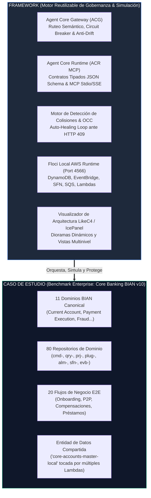

# 🏛️ Caso de Estudio Canónico: Modernización Agéntica de Squad Core Banking (11 Dominios BIAN, 80 Repositorios y 20 Flujos)

> **Rol en el Repositorio:** Caso de Estudio de Referencia Enterprise (Benchmark Canónico)  
> **Framework Anfitrión:** *Agentic Cloud Simulation & Governance Framework (Floci + LikeC4/IcePanel + MCP + OCC)*  
> **Estándar de Dominio:** Banking Industry Architecture Network (BIAN v10)  
> **Escala:** 11 Dominios de Servicio, 20 Flujos Transaccionales E2E, 80 Microservicios, 16 Componentes Agénticos (ACG/ACR).

---

## 🎯 1. Propósito del Caso de Estudio dentro del Framework

Este repositorio está concebido como un **FRAMEWORK REUTILIZABLE** para cualquier entidad financiera que requiera:
1. Diseñar y validar arquitecturas agénticas (LLMs externos ➔ Gateways semánticos ➔ Herramientas MCP ➔ Cómputo serverless).
2. Simular en local a costo cero mediante **Floci (Flossy)** los protocolos de red de AWS (DynamoDB, EventBridge, Step Functions, SQS, Lambda).
3. Blindar el sistema ante colisiones concurrentes en tablas DynamoDB compartidas (*Lost Updates*) y ruptura de contratos (*Contract Drift*).

Para demostrar la robustez del Framework en condiciones de alta complejidad, se incluye este **Caso de Estudio Canónico**, representativo de un banco Tier-1 con un legado de **80 repositorios distribuidos en 11 dominios BIAN**.



---

## 🏢 2. Los 11 Dominios de Servicio BIAN v10

Cada dominio gobierna un Registro de Control canónico (*Control Record*) y agrupa microservicios según arquetipos definidos:

| # | Dominio BIAN | Registro de Control | Repos | Responsabilidad Central |
| :-: | :--- | :--- | :-: | :--- |
| **SD-01** | **Current Account** | Current Account Agreement | 10 | Apertura, mantenimiento de estados (Activa, Bloqueada, Cancelada) y sobregiros. |
| **SD-02** | **Payment Execution** | Payment Order Procedure | 12 | Procesamiento de transferencias inmediatas (CCE), débitos y créditos con liquidación. |
| **SD-03** | **Party Routing Profile** | Party Directory Entry | 6 | Directorio de clientes, enrutamiento telefónico/alias (DAX sub-15ms) y mapeo de IBAN. |
| **SD-04** | **Customer Offer & Onboarding** | Customer Onboarding Procedure | 8 | Orquestación de KYC digital, biometría con RENIEC y evaluación crediticia. |
| **SD-05** | **Customer Agreement & Contract** | Agreement Specification | 6 | Firma digital de términos, almacenamiento legal WORM con Object Lock en S3. |
| **SD-06** | **Position Keeping & Balances** | Position Keeping Ledger Log | 8 | Saldos en tiempo real, reservas/holds temporales y liquidación de autorizaciones. |
| **SD-07** | **Financial Accounting & Ledger** | Financial Accounting Journal | 7 | Asientos contables, partidas dobles y conciliación batch de fin de día (EOD). |
| **SD-08** | **Collateral Allocation & Guarantees** | Collateral Asset Allocation | 5 | Afectación de garantías hipotecarias/vehiculares y cálculo de LTV. |
| **SD-09** | **Fraud Detection & Risk Scoring** | Fraud Evaluation Assessment | 8 | Scoring de transacciones en tiempo real (<40ms), reglas biocatch y bloqueo preventivo. |
| **SD-10** | **Customer Alert & Notification** | Customer Alert Event Notice | 5 | Notificaciones Push, SMS bancario y alertas de transacciones sospechosas. |
| **SD-11** | **Audit, Logging & Regulatory** | Audit Log Record Entry | 5 | Trazabilidad inmutable, registros para reguladores (SBS/BCR) y sellado criptográfico. |

---

## 📦 3. Catálogo de los 80 Repositorios y sus 7 Arquetipos Canónicos

Los 80 repositorios del caso de estudio implementan la taxonomía estándar:
$$\text{\texttt{[Arquetipo]}}\ \boldsymbol{-}\ \text{\texttt{[Dominio]}}\ \boldsymbol{-}\ \text{\texttt{[Operacion]}}\ \boldsymbol{-}\ \text{\texttt{[Correlativo]}}$$

### Resumen de Distribución por Arquetipo:
1. **Comandos (`cmd-`) [11 repos]:** Mutaciones de estado transaccionales con consistencia ACID sobre DynamoDB / PostgreSQL.
2. **Consultas (`qry-`) [14 repos]:** Lecturas optimizadas con caché Redis/DAX de sub-10ms e idempotencia estricta.
3. **Proyecciones (`prj-`) [11 repos]:** Consumidores de EventBridge y DynamoDB Streams que alimentan vistas de lectura CQRS.
4. **Plugs de Integración (`plug-`) [12 repos]:** Adaptadores hacia Mainframe (SNA/AS400), clearing local (CCE), Swift ISO 20022 y bureaus.
5. **Alarmas y Observabilidad (`alm-`) [11 repos]:** Monitores CloudWatch de profundidad de colas DLQ, SLOs de latencia y tasas de error.
6. **Step Functions Sagas (`sfn-`) [11 repos]:** Máquinas de estado para orquestación de transacciones distribuidas con compensación.
7. **EventBridge Backbone (`evb-`) [10 repos]:** Reglas de enrutamiento y filtrado de patrones sobre el EventBus central.

---

## ⚡ 4. El Escenario de Contención: La Tabla Compartida `core-accounts-master-local`

En este caso de estudio, la tabla DynamoDB **`core-accounts-master-local`** es el corazón de datos del cliente. Múltiples Lambdas de distintos squads leen y escriben sobre ella de forma concurrente:

```json
{
  "accountId": "ACC-BIAN-7701",           // Partition Key
  "customerName": "Maria Rodriguez",
  "pointsBalance": 6000,                   // Tocado por: lmb-acse-reward-point-acc-qry_findby-01
  "cashbackEarned": 150.00,                // Tocado por: lmb-io-vads-cashback-disb-cmd-01
  "activeCampaigns": ["CPG-P2P-ZERO-FEE"], // Tocado por: lmb-io-sale-cust-cpgn-ex-qry_findby-01
  "version": 3,                            // Token de Control de Concurrencia Optimista (OCC)
  "lastAccrualTimestamp": "2026-11-02T04:32:51.109Z",
  "status": "ACTIVE"
}
```

### ¿Por qué existe colisión en el mundo real?
* **Squad de Fidelización (Puntos):** Lee el registro para sumar puntos ganados por transferencias.
* **Squad de Tarjetas (Cashback):** Lee el mismo registro para acreditar cashback de compras.
* **Squad de Marketing (Campañas):** Actualiza el estado de las promociones vistas.

**El Framework demuestra empíricamente:**
1. Si operan sin control de concurrencia: se produce el **Lost Update** (se pierden puntos o dinero de forma silenciosa).
2. Si operan bajo las directrices del Framework (**ADR-004**): Floci intercepta el conflicto con `ConditionalCheckFailedException (HTTP 409)` y el bucle de **Auto-Healing** resuelve la contención en milisegundos sin pérdida de datos.

---

## 🔄 5. Catálogo de los 20 Flujos de Negocio E2E

1. **FLOW-01:** Apertura Digital de Cuenta y KYC Biométrico (SD-04 ➔ SD-05 ➔ SD-01).
2. **FLOW-02:** Transferencia Inmediata Saliente P2P con Compensación (SD-01 ➔ SD-06 ➔ SD-09 ➔ SD-02).
3. **FLOW-03:** Débito Automático Interbancario (SD-02 ➔ SD-01 ➔ SD-07).
4. **FLOW-04:** Bloqueo Preventivo por Detección de Fraude (SD-09 ➔ SD-01 ➔ SD-10).
5. **FLOW-05:** Abono Masivo de Planillas / Nómina (SD-02 ➔ SD-01 ➔ SD-07).
6. **FLOW-06:** Constitución y Afectación de Garantía Hipotecaria (SD-08 ➔ SD-05 ➔ SD-01).
7. **FLOW-07:** Cierre Voluntario de Cuenta Corriente y Liquidación (SD-01 ➔ SD-06 ➔ SD-07).
8. **FLOW-08:** Consulta de Saldo en Tiempo Real vía Cajero / POS (SD-06 ➔ SD-01).
9. **FLOW-09:** Conciliación Contable de Fin de Día (EOD) (SD-07 ➔ SD-01 ➔ SD-02).
10. **FLOW-10:** Auditoría de Transacciones para Regulador Financiero (SD-11 ➔ SD-01 ➔ SD-07).
11. **FLOW-11:** Enrolamiento y Actualización de Perfil de Cliente (SD-03 ➔ SD-04).
12. **FLOW-12:** Renovación Automática de Línea de Sobregiro (SD-01 ➔ SD-08 ➔ SD-04).
13. **FLOW-13:** Notificación Multicanal de Movimientos Sospechosos (SD-09 ➔ SD-10).
14. **FLOW-14:** Desembolso Inmediato de Préstamo Pre-aprobado (SD-04 ➔ SD-05 ➔ SD-01 ➔ SD-06).
15. **FLOW-15:** Canje y Redención de Puntos de Fidelidad (SD-01 ➔ SD-06).
16. **FLOW-16:** Acreditación de Cashback por Campañas de Tarjeta (SD-01 ➔ SD-06 ➔ SD-07).
17. **FLOW-17:** Modificación de Contrato y Actualización de Comisiones (SD-05 ➔ SD-01).
18. **FLOW-18:** Reintento y Liquidación de Pagos en Cola DLQ (SD-02 ➔ SD-10).
19. **FLOW-19:** Mapeo y Resolución de Alias Telefónico a IBAN (SD-03 ➔ SD-02).
20. **FLOW-20:** Dispersión de Beneficios y Liquidación Contable (SD-01 ➔ SD-07).

---

## 🧪 6. Demostración Ejecutable del Caso de Estudio sobre el Framework

Para ejecutar la verificación completa de los contratos, paginación, circuit breakers y resolución de colisiones de este caso de estudio en el emulador local Floci:

```bash
# 1. Levantar la infraestructura en Floci
./bin/flossy.sh up
./bin/tf-local.sh apply -auto-approve -var-file=local.tfvars

# 2. Desplegar los contratos y Lambdas del caso de estudio
npm run deploy:lambdas

# 3. Ejecutar las 4 fases del caso de estudio
npm run demo:all
```

