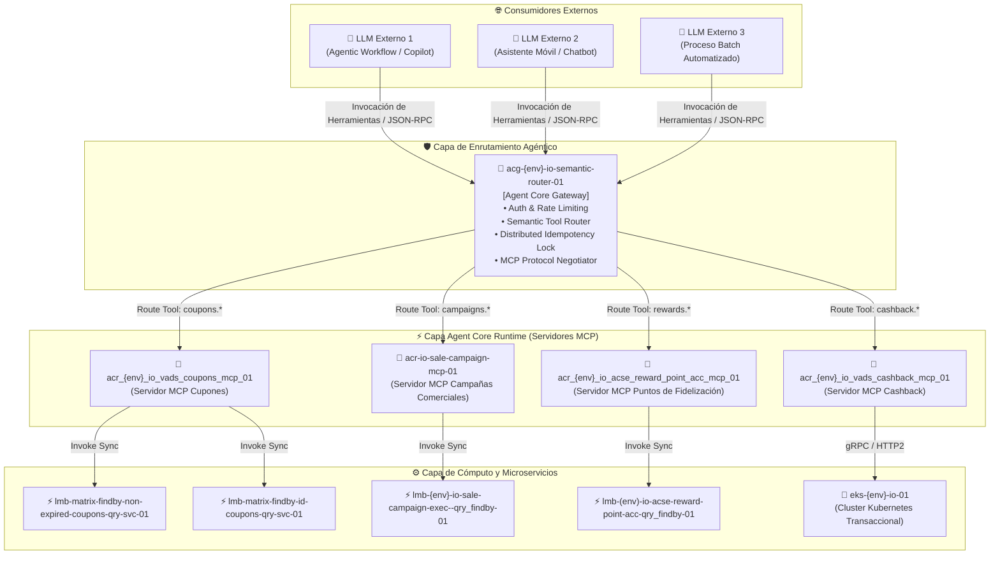
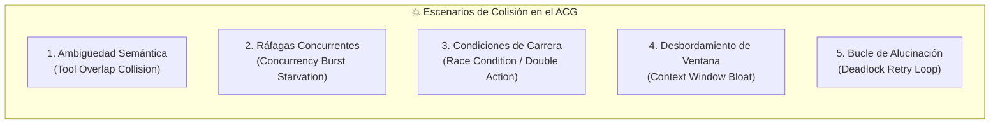

# 🚀 Arquitectura Demo & Análisis de Colisión: ACG $\rightarrow$ ACR (MCP) $\rightarrow$ LMB / EKS

Este documento diseña la arquitectura del flujo **Agent Core Gateway (ACG)** hacia **Agent Core Runtime (ACR - MCP)** y su integración con **Lambdas (`lmb`)** y **Contenedores (`eks`)**, analizando en profundidad **cómo y por qué puede colisionar el ACG ante ráfagas de consultas desde LLMs externos**.

---

## 🏛️ 1. Diagrama de la Arquitectura del Flujo

---

## 💥 2. Análisis de Colisiones en el ACG ante Consultas de LLMs Externos

Cuando múltiples LLMs externos consumen el Gateway (`acg`), se producen **5 tipos críticos de colisión arquitectónica**:

### 🔴 Colisión 1: Ambigüedad de Enrutamiento Semántico (Tool Overlap Collision)
* **El Problema:** Tienes dos servidores ACR con herramientas conceptualmente parecidas:
  * `acr_vads_coupons_mcp_01` ofrece `find_coupons_by_id`.
  * `acr-io-sale-campaign-mcp-01` ofrece `find_campaign_coupons`.
* **Mecanismo de Colisión:** Cuando un LLM externo envía una consulta en lenguaje natural difusa (*"Dame los cupones activos del cliente para la campaña de hoy"*), el enrutador del ACG sufre una caída de confianza semántica (<80%). Si el ACG divide la consulta o la envía al runtime equivocado, o invoca a ambos en paralelo, genera respuestas contradictorias o duplicadas hacia el usuario final.

### 🔴 Colisión 2: Ráfaga de Concurrencia y Agotamiento de Lambdas (Concurrency Burst Starvation)
* **El Problema:** Los LLMs avanzados (como GPT-4o o Claude 3.5 Sonnet) utilizan **ejecución paralela de herramientas** (`tool_calls` múltiples en un solo turno).
* **Mecanismo de Colisión:** Un solo prompt de usuario puede desencadenar que el LLM externo dispare **8 llamadas simultáneas** hacia el ACG. Si 10 LLMs concurrentes hacen lo mismo, el ACG recibe **80 requests instantáneas** hacia las Lambdas `lmb-matrix-findby-*`. Si estas Lambdas no tienen *provisioned concurrency*, se produce una colisión masiva por **Cold Starts** acumulados (>3,000ms) o respuestas `429 Too Many Requests (Rate Exceeded)`.

### 🔴 Colisión 3: Condición de Carrera en Estado y Doble Transacción (Race Condition)
* **El Problema:** Consultas concurrentes que mutan o reservan beneficios (ej. reclamar un cashback o descontar puntos en `acr_acse_reward_point_acc_mcp_01`).
* **Mecanismo de Colisión:** Si dos agentes externos intentan aplicar el mismo cupón para el mismo cliente con 100ms de diferencia, y el ACG no implementa un **candado distribuido por cliente** (`distributed lock via Redis / ElastiCache`), ambas llamadas pasarán la validación en paralelo en `lmb`, provocando un **doble canje de beneficio**.

### 🔴 Colisión 4: Desbordamiento de Contexto (Context Window & Payload Bloat)
* **El Problema:** La función `lmb-matrix-findby-non-expired-coupons-qry-svc-01` devuelve 800 cupones en un JSON crudo de 3 MB.
* **Mecanismo de Colisión:** El ACR empaqueta el JSON crudo en el protocolo MCP. Cuando el ACG lo retorna al LLM externo, el payload **supera el límite de tokens de entrada o el tamaño máximo de paquete MCP (4MB)**, provocando que la sesión del LLM falle con error `HTTP 502 / Context Window Overflow`.

### 🔴 Colisión 5: Bucle Muerto por Reintentos de Alucinación (Hallucination Retry Loop)
* **El Problema:** Una Lambda devuelve un error de validación de negocio (ej. `COUPON_NOT_APPLICABLE_FOR_CATEGORY`).
* **Mecanismo de Colisión:** El LLM externo asume que los parámetros fueron incorrectos y reintenta automáticamente con variaciones infinitesimales hasta 5 veces. Si 20 agentes entran en este patrón, el ACG se satura procesando llamadas zombis que nunca tendrán éxito.

---

## 🛡️ 3. Estrategias de Mitigación en el ACG (Patrones Defensivos)

Para evitar que el ACG colisione en tu demo, se deben implementar 4 salvaguardas:

1. **Particionamiento de Nombres de Herramientas (Namespacing Estricto):**
   * En lugar de registrar herramientas genéricas como `findby_id`, el ACG exige:
     `vads.coupons.findby_id` y `sale.campaign.findby_id`.
2. **Candado Distribuido de Idempotencia (`Idempotency-Key` + ElastiCache Redis):**
   * El ACG extrae un hash de `(customerId + action + params)` con un TTL de 10 segundos. Si llega una llamada idéntica en vuelo, se rechaza o devuelve la respuesta en caché.
3. **Paginación y Truncamiento Semántico en el ACR:**
   * Las Lambdas de consulta (`qry_findby`) nunca devuelven más de 20 registros por defecto hacia el contexto del LLM.
4. **Circuit Breaker y Rate Limiting por Sesión de Agente:**
   * Token Bucket en el ACG que limita a cada agente externo a un máximo de 10 tool calls por minuto.

---

## 🎯 4. ¿Qué nos faltaría exactamente para iniciar la Demo?

Para poner a correr esta demo en vivo en tu máquina dentro de este repositorio, solo requerimos **4 elementos puntuales**:

| # | Elemento Faltante | Estado Actual | Acción Inmediata |
| :-: | :--- | :---: | :--- |
| **1** | **Modelo LikeC4 del Flujo ACG $\rightarrow$ ACR $\rightarrow$ LMB** | 🟡 Listo en diseño | Inyectar la vista dinámica en `likec4/src/architecture.c4` para visualizar el flujo en el canvas. |
| **2** | **Servidor Mock del ACG con Detección de Colisiones** | 🟡 Pendiente | Crear un script ligero en Node.js (`bin/acg-gateway-demo.mjs`) que exponga el endpoint HTTP/MCP del ACG. |
| **3** | **Arnés de Simulación de Carga Concurrente de LLMs** | 🟡 Pendiente | Script de pruebas (`bin/test-acg-collision-sim.mjs`) que dispare 20 consultas paralelas simulando LLMs externos. |
| **4** | **Emulador Floci corriendo localmente** | 🟢 Listo | Ejecutar `make up` para tener el puerto 4566 listo para persistencia local. |

