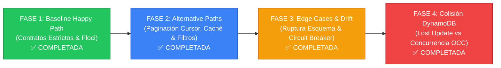
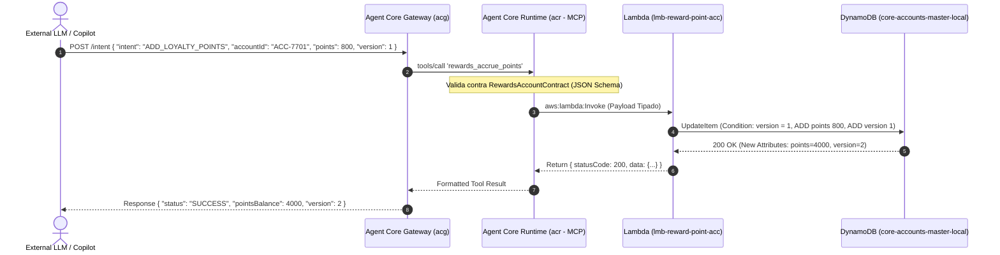
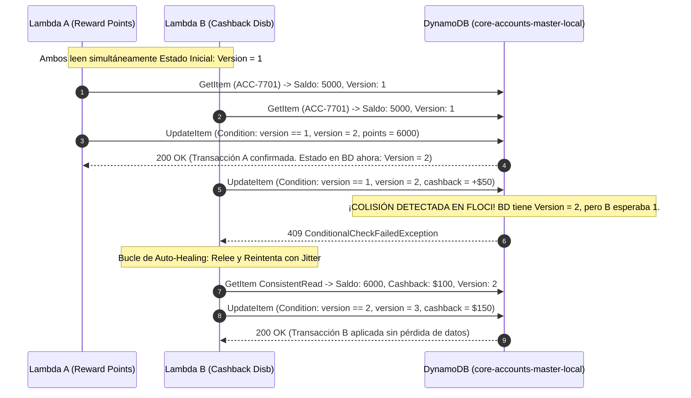

# 🏛️ Marco de Gobernanza de Contratos API y Análisis de Colisiones en Topologías Agénticas (ACG -> ACR -> Lambdas -> DynamoDB)

> **Destinatarios:** Architecture Review Board (ARB), Principal Architects, Squad Leads & Core Banking Engineers.  
> **Ámbito:** BIAN v10 Service Domains, Agent Core Gateway (ACG), Agent Core Runtime (ACR MCP) y Microservicios Serverless en AWS / Floci.

---

## 📑 1. Catálogo de Artefactos Documentales Obligatorios en Banca Corporativa

Para defender y sustentar este análisis ante un Comité de Arquitectura Corporativo (ARB / Enterprise Architecture Board), se requiere la siguiente **batería formal de 5 artefactos documentales**:

| ID | Tipo de Artefacto | Propósito en el Banco | Estándar / Notación | Enlace en el Repositorio |
| :--- | :--- | :--- | :--- | :--- |
| **ART-01** | **ADRs (Architectural Decision Records)** | Documenta decisiones irreversibles, compensaciones (*trade-offs*) y directrices técnicas obligatorias para los squads. | Formato Michael Nygard (Contexto, Decisión, Consecuencias). | [ADR-001](ADR-001-STRICT-CONTRACTS-ACR-LAMBDA.md), [ADR-002](ADR-002-CURSOR-PAGINATION-AND-DEGRADED-CACHE.md), [ADR-003](ADR-003-CIRCUIT-BREAKER-PHANTOM-SERVICES.md), [ADR-004](ADR-004-OPTIMISTIC-CONCURRENCY-MULTI-LAMBDA-DYNAMO.md) |
| **ART-02** | **Catálogo de Contratos API Multinivel** | Especifica los esquemas de entrada y salida entre el Gateway, el Servidor MCP y las Lambdas de dominio. | JSON Schema Draft 2020-12 / OpenAPI 3.1 / OpenRPC. | [`src/contracts/`](../../src/contracts/) |
| **ART-03** | **Diagramas de Secuencia Dinámicos** | Modela el comportamiento temporal, transformaciones de carga y códigos de estado en las 4 fases de ejecución. | Mermaid `sequenceDiagram` integrado en Markdown vivo. | [Sección 4 de esta especificación](#4-diagramas-de-secuencia-canónicos) |
| **ART-04** | **Matriz de Riesgo de Colisión de Datos** | Cruza microservicios concurrentes contra atributos compartidos en tablas DynamoDB (Single-Table / Multi-Table). | Matriz CRUD Matricial con Nivel de Concurrencia y Aislamiento. | [Sección 3 de esta especificación](#3-matriz-de-riesgo-de-colisión-de-datos-shared-dynamodb-table) |
| **ART-05** | **Suites de Pruebas Deterministas** | Harnesses de prueba reproducibles que validan cada fase contra el emulador local de AWS (Floci). | Scripts ejecutables Node.js + AWS SDK v3. | `npm run demo:phase1` a `demo:phase4` |

---

## 🗺️ 2. Hoja de Ruta de 4 Fases (Evolución Paso a Paso)

### 🟢 Fase 1: Baseline Happy Path & Contratos Tipados
* **Objetivo:** Demostrar el flujo limpio de extremo a extremo en Floci (`localhost:4566`).
* **Comportamiento:** El LLM externo envía una intención limpia (`FIND_COUPON`, `CHECK_POINTS_BALANCE`, `ADD_LOYALTY_POINTS`). El Gateway valida el esquema, el MCP invoca la Lambda correspondiente en Floci y DynamoDB almacena el estado sin fricción.
* **Comando:** `npm run demo:phase1`
* **ADR Asociado:** [ADR-001: Contratos Estrictos en ACR y Prevención de Colisiones](ADR-001-STRICT-CONTRACTS-ACR-LAMBDA.md)

### 🔵 Fase 2: Alternative Paths (Paginación Cursor-Based y Enriquecimiento)
* **Objetivo:** Prevenir el *Context Window Bloat* y alucinación del LLM cuando un endpoint devuelve catálogos masivos.
* **Comportamiento:** 
  1. *Paginación Cursor-based:* Aplica corte a 3 registros y retorna un token base64 opaco `nextCursorToken` con metadatos `totalMatched` y `hasMore`.
  2. *Filtrado Semántico:* Soporte para filtrado por categoría (`category: "TRAVEL"`, `"RETAIL"`) en el borde antes de la transferencia por red.
* **Comando:** `npm run demo:phase2`
* **ADR Asociado:** [ADR-002: Paginación Cursor-Based y Prevención de Context Window Bloat](ADR-002-CURSOR-PAGINATION-AND-DEGRADED-CACHE.md)

### 🟡 Fase 3: Edge Cases, Deriva de Contratos y Circuit Breaker
* **Objetivo:** Proteger el Core Banking ante LLMs rebeldes, esquemas rotos y dependencias no disponibles.
* **Comportamiento:**
  1. *Schema Incompatibility (Anti-Drift):* Rechaza en 1ms entradas con tipos corruptos (ej. `couponId: 98765` numérico en lugar de string regex) con pistas semánticas para auto-corrección.
  2. *Componentes [POR CREAR]:* Detecta estado en desarrollo y retorna HTTP 501 `CAPABILITY_UNDER_CONSTRUCTION` con alternativas funcionales.
  3. *Servicios Phantom [NO EXISTE]:* Detecta ausencia de la Lambda `lmb-made-campaign-pjc`, dispara el Circuit Breaker a `OPEN` y devuelve HTTP 503 con degradación elegante, blindando al sistema de caídas en cascada.
* **Comando:** `npm run demo:phase3`
* **ADR Asociado:** [ADR-003: Circuit Breaker Semántico y Auto-Recuperación ante Servicios Inexistentes](ADR-003-CIRCUIT-BREAKER-PHANTOM-SERVICES.md)

### 🔴 Fase 4: Colisión Concurrente en Tabla Compartida de DynamoDB
* **Objetivo:** Resolver el problema crítico donde múltiples Lambdas independientes tocan la misma tabla DynamoDB (`core-accounts-master-local`).
* **Demostración 4.1 (The Lost Update Disaster):**
  - Lambda A suma 1,000 puntos (saldo: 6000).
  - Lambda B concurrente abona $50 de cashback pero con un snapshot desactualizado (5000 pts) sobreescribiendo ciegamente el registro.
  - **Resultado:** Pérdida silenciosa de 1,000 puntos del cliente.
* **Demostración 4.2 (La Solución con OCC + Auto-Healing):**
  - Lambda A escribe con `version = 1`, dejando la tabla en `version = 2`.
  - Lambda B intenta escribir esperando `version = 1`. Floci dispara `ConditionalCheckFailedException (HTTP 409)`.
  - Bucle de Auto-Healing de Lambda B: re-lee el ítem fresco con consistencia fuerte (`ConsistentRead: true`), re-evalúa el cálculo encima del saldo nuevo, y consolida la transacción en `version = 3`.
  - **Resultado:** Cero pérdida de datos (6,000 pts + $150 cashback intactos).
* **Comando:** `npm run demo:phase4`
* **ADR Asociado:** [ADR-004: Control de Concurrencia Optimista (OCC) y Prevención de Lost Update](ADR-004-OPTIMISTIC-CONCURRENCY-MULTI-LAMBDA-DYNAMO.md)

---

## 📊 3. Matriz de Riesgo de Colisión de Datos (Shared DynamoDB Table)

Cuando múltiples microservicios comparten la entidad de Cuenta en `core-accounts-master-local`:

| Lambda / Microservicio | Operación | Campos que Lee | Campos que Modifica | Riesgo de Colisión | Mecanismo de Mitigación Obligatorio |
| :--- | :--- | :--- | :--- | :---: | :--- |
| `lmb-...-reward-point-acc-qry` | Mutation / Query | `accountId`, `pointsBalance`, `version` | `pointsBalance`, `lastAccrualTimestamp`, `version` | 🔴 **ALTO** | **OCC con Token de Versión (`version = :expVer`)** y retry con Jitter. |
| `lmb-...-card-cashback-disb` | Mutation | `accountId`, `cashbackEarned`, `version` | `cashbackEarned`, `lastAccrualTimestamp`, `version` | 🔴 **ALTO** | **OCC con Token de Versión** y Auto-Healing loop. |
| `lmb-...-sale-cust-cpgn-ex-qry` | Mutation | `accountId`, `activeCampaigns` | `activeCampaigns`, `lastTouchpoint` | 🟡 **MEDIO** | Expresiones atómicas aisladas (`SET activeCampaigns = :val`). |
| `lmb-...-findby-id-coupons-qry` | Query (Solo Lectura) | `couponId`, `status`, `rules` | *Ninguno (Read-Only)* | 🟢 **NULO** | Lectura idempotente con consistencia eventual. |
| `lmb-...-non-expired-coupons-qry` | Query Paginada | `customerId`, `category` | *Ninguno (Read-Only)* | 🟢 **NULO** | Paginación cursor-based con limit y token base64. |

---

## 📈 4. Diagramas de Secuencia Canónicos

### Secuencia Fase 1: Happy Path Tipado

### Secuencia Fase 4: Detección y Mitigación de Colisión Concurrente (OCC)

