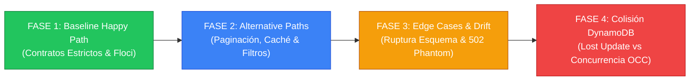
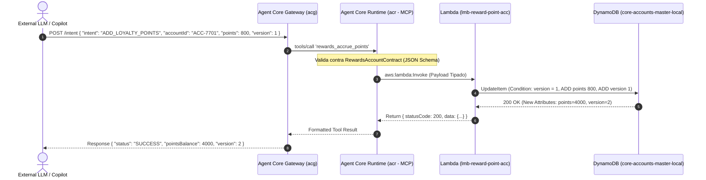
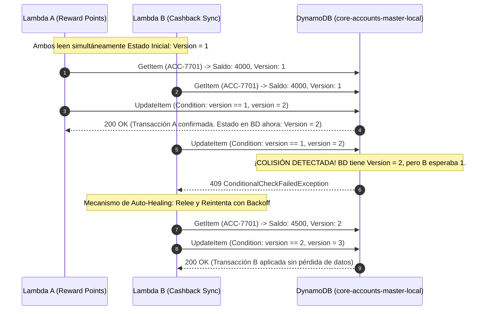

# 🏛️ Marco de Gobernanza de Contratos API y Análisis de Colisiones en Topologías Agenticas (ACG -> ACR -> Lambdas -> DynamoDB)

> **Destinatarios:** Architecture Review Board (ARB), Principal Architects, Squad Leads & Core Banking Engineers.  
> **Ámbito:** BIAN v10 Service Domains, Agent Core Gateway (ACG), Agent Core Runtime (ACR MCP) y Microservicios Serverless en AWS / Floci.

---

## 📑 1. Catálogo de Artefactos Documentales Obligatorios en Banca Corporativa

Para defender y sustentar este análisis ante un Comité de Arquitectura Corporativo (ARB / Enterprise Architecture Board), no basta con diagramas estáticos de cajas. Se exige la siguiente **batería formal de 5 artefactos documentales**:

| ID | Tipo de Artefacto | Propósito en el Banco | Estándar / Notación |
| :--- | :--- | :--- | :--- |
| **ART-01** | **ADR (Architectural Decision Record)** | Documenta decisiones irreversibles, compensaciones (*trade-offs*) y directrices técnicas obligatorias para los squads. | Formato Michael Nygard (Contexto, Decisión, Consecuencias). |
| **ART-02** | **Catálogo de Contratos API Multinivel** | Especifica los esquemas de entrada y salida entre el Gateway, el Servidor MCP y las Lambdas de dominio. | JSON Schema Draft 2020-12 / OpenAPI 3.1 / OpenRPC. |
| **ART-03** | **Diagramas de Secuencia Dinámicos** | Modela el comportamiento temporal, transformaciones de carga y códigos de estado en las 4 fases de ejecución. | Mermaid `sequenceDiagram` integrado en Markdown vivo. |
| **ART-04** | **Matriz de Riesgo de Colisión de Datos** | Cruza microservicios concurrentes contra atributos compartidos en tablas DynamoDB (Single-Table / Multi-Table). | Matriz CRUD Matricial con Nivel de Concurrencia y Aislamiento. |
| **ART-05** | **Diagrama de Actividad / Máquina de Estados** | Detalla la validación de contratos, manejo de fallbacks y reintentos con backoff exponencial. | Mermaid `stateDiagram-v2` / `flowchart TD`. |

---

## 🗺️ 2. Hoja de Ruta de 4 Fases (Evolución Paso a Paso)

### 🟢 Fase 1: Baseline Happy Path & Contratos Tipados (COMPLETADA)
* **Objetivo:** Demostrar el flujo limpio de extremo a extremo en Floci (`localhost:4566`).
* **Comportamiento:** El LLM externo envía una intención limpia (`FIND_COUPON`, `CHECK_POINTS_BALANCE`, `ADD_LOYALTY_POINTS`). El Gateway valida el esquema, el MCP invoca la Lambda correspondiente en Floci y DynamoDB almacena el estado sin fricción.
* **Comando:** `npm run demo:phase1`

### 🔵 Fase 2: Alternative Paths (Respuestas Parciales y Enriquecimiento)
* **Objetivo:** Manejar escenarios donde los datos existen parcialmente o requieren paginación.
* **Comportamiento:** 
  1. *Paginación Cursor-based:* Si una consulta de cupones retorna 500 registros, el MCP no puede volcar 3 MB al LLM (saturaría el context window). Aplica corte a 5 registros y retorna `nextCursor`.
  2. *Caché Local:* Lecturas de solo lectura consumen réplicas DAX/Redis locales en Floci antes de golpear DynamoDB.

### 🟡 Fase 3: Edge Cases & Ruptura de Contrato (Contract Drift)
* **Objetivo:** Evaluar la resiliencia del sistema ante clientes o servicios rebeldes.
* **Comportamiento:**
  1. *Schema Incompatibility:* El cliente envía `couponId: 12345` (número en vez de string bajo regex `^CPN-...`). El ACR intercepta el fallo y devuelve `400 BAD_REQUEST` con descripción semántica para que el LLM se auto-corrija.
  2. *Dependencia Inexistente:* Invocación a `lmb-(env)-io-made-campaign-dsg-pjc_findby-id-01` (`no existe`). El Gateway activa un *Circuit Breaker* en lugar de propagar un `502 Bad Gateway` opaco.

### 🔴 Fase 4: Colisión Concurrente en Tabla Compartida de DynamoDB
* **Objetivo:** Resolver el problema crítico bancario donde múltiples Lambdas independientes tocan la misma tabla DynamoDB (`core-accounts-master-local`).
* **El Problema del "Lost Update":**
  - La Lambda `A` (`reward-point-acc`) lee el ítem (Saldo: 4000 pts).
  - La Lambda `B` (`sale-cust-cpgn`) lee el mismo ítem en paralelo para actualizar campañas.
  - La Lambda `A` suma 500 pts y escribe Saldo: 4500.
  - La Lambda `B` escribe su carga sin conocer la suma de `A`, sobreescribiendo el ítem y borrando los 500 puntos (Pérdida financiera).
* **La Solución Arquitectónica:** *Optimistic Concurrency Control (OCC)* mediante `ConditionExpression: attribute_exists(accountId) AND version = :expVer` y expresiones atómicas `ADD pointsBalance :inc`.

---

## 📊 3. Matriz de Riesgo de Colisión de Datos (Shared DynamoDB Table)

Cuando múltiples microservicios comparten la entidad de Cuenta en `core-accounts-master-local`:

| Lambda / Microservicio | Operación | Campos que Lee | Campos que Modifica | Riesgo de Colisión | Mecanismo de Mitigación Obligatorio |
| :--- | :--- | :--- | :--- | :---: | :--- |
| `lmb-...-reward-point-acc-qry` | Mutation / Query | `accountId`, `pointsBalance`, `version` | `pointsBalance`, `lastAccrualTimestamp`, `version` | 🔴 **ALTO** | **OCC con Token de Versión (`version = :expVer`)** y retry con Jitter. |
| `lmb-...-sale-cust-cpgn-ex-qry` | Mutation | `accountId`, `activeCampaigns` | `activeCampaigns`, `lastTouchpoint` | 🟡 **MEDIO** | Expresiones atómicas aisladas (`SET activeCampaigns = :val`). |
| `lmb-...-findby-id-coupons-qry` | Query (Solo Lectura) | `couponId`, `status`, `rules` | *Ninguno (Read-Only)* | 🟢 **NULO** | Lectura idempotente con consistencia eventual. |
| `lmb-...-card-cashback-disb` | Mutation | `accountId`, `cashbackEarned`, `version` | `cashbackEarned`, `version` | 🔴 **ALTO** | Transacciones ACID (`TransactWriteItems`) multi-ítem. |

---

## 📈 4. Diagramas de Secuencia Canónicos

### Secuencia Fase 1: Happy Path Tipado

### Secuencia Fase 4: Detección y Mitigación de Colisión Concurrente (OCC)

