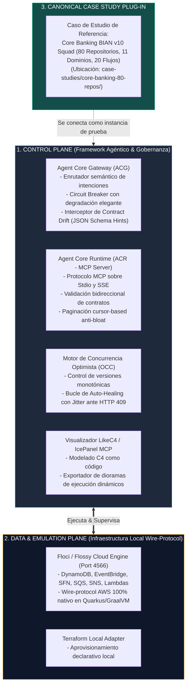

# 🚀 Arquitectura del Framework: Simulación Agéntica, Contratos y Gobernanza Cloud (Floci + LikeC4 + MCP + OCC)

> **Tipo de Software:** Framework de Ingeniería de Software y Gobernanza Cloud Agéntica  
> **Propósito:** Proveer un arnés de simulación local, desacoplamiento de herramientas MCP y protección ante colisiones en arquitecturas Serverless y NoSQL para agentes de Inteligencia Artificial.

---

## 🏗️ 1. Visión y Desacoplamiento del Framework

El **Agentic Cloud Simulation & Governance Framework** está diseñado de forma agnóstica para permitir que cualquier squad o institución pruebe arquitecturas complejas sin depender de nubes de pago ni desplegar código prematuro.

El framework opera en **dos planos desacoplados**:

---

## 🧩 2. Módulos Nucleares del Framework

### A. Módulo Ingress: Agent Core Gateway (`src/gateway/agent-core-gateway.mjs`)
* **Enrutamiento Semántico:** Traduce lenguaje natural o intenciones estructuradas (`ADD_LOYALTY_POINTS`, `FIND_COUPON`, `DISBURSE_CASHBACK`) a herramientas MCP registradas.
* **Circuit Breaker:** Mantiene máquinas de estado (`CLOSED`, `OPEN`, `HALF_OPEN`) sobre dependencias backend. Si un servicio está en construcción (`[POR CREAR]`) o no existe (`[NO EXISTE]`), fast-falla en 1ms devolviendo respuestas degradadas en vez de tumbar la pasarela.

### B. Módulo Herramientas: Agent Core Runtime MCP (`src/gateway/agent-core-runtime-mcp.mjs`)
* **Cumplimiento de Contratos:** Evalúa parámetros de entrada contra esquemas JSON Schema Draft 2020-12. Si un tipo viene corrupto, devuelve un error 400 semántico con pistas para que el LLM se auto-corrija.
* **Paginación Cursor-Based:** Fragmenta respuestas masivas en bloques acotados para evitar el *Context Window Bloat* de los LLMs.

### C. Módulo Persistencia y Concurrencia: OCC Engine
* **Invariante de Versión Monotónica:** Toda tabla NoSQL o entidad compartida por múltiples Lambdas implementa una clave de versión `version`.
* **Auto-Healing ante HTTP 409:** Si ocurre una colisión en DynamoDB (`ConditionalCheckFailedException`), el framework re-lee el ítem con consistencia fuerte (`ConsistentRead: true`), recalcula y reintenta con backoff exponencial y jitter aleatorio.

### D. Módulo de Emulación: Floci Local AWS (`bin/flossy.sh` & `docker-compose.yml`)
* Provee emulación de infraestructura local a costo cero en el puerto `4566`.
* No requiere emuladores pesados ni mocks estáticos; responde a llamadas HTTP con la firma criptográfica y comportamiento real de AWS.

---

## 🔌 3. Cómo Conectar un Nuevo Caso de Estudio al Framework

Para que otro squad o institución aplique el Framework a su propia arquitectura:
1. **Definir el Manifiesto de Repositorios:** Crear un archivo `squad-manifest.json` con los microservicios y arquetipos del squad.
2. **Crear los Contratos API:** Ubicar los esquemas JSON de entrada y salida en `src/contracts/`.
3. **Escribir los Handlers Lambda:** Implementar las funciones de cómputo en `src/lambdas/` con el envoltorio de respuesta estándar.
4. **Registrar las Herramientas en el Gateway:** Mapear las intenciones al runtime en `src/gateway/`.
5. **Ejecutar la Suite de Pruebas:** Correr el arnés para verificar la ausencia de colisiones y la integridad de contratos.
